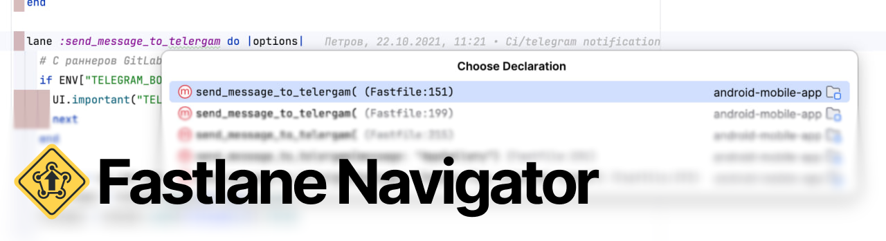

<p align="center">Fastlane editing, lane navigation, and formatting for IntelliJ-based IDEs.</p>

<p align="center">
  <a href="https://github.com/stfbee/android-studio-fastlane/actions/workflows/build.yml"></a>
  <a href="https://github.com/stfbee/android-studio-fastlane/releases/latest"></a>
  <a href="#requirements"></a>
</p>

<p align="center">English · <a href="README.ru.md">Русский</a></p>

## Features

- **Navigate between lanes and calls.** Jump to declarations, find usages, and return to callers within a Fastfile. Platform-specific lanes are resolved in context.
- **Explore your Fastfile.** Browse platforms, public, private, and override lanes in Structure and File Structure, with descriptions from `desc`.
- **Jump from CI to code.** Open lane declarations from GitHub Actions and GitLab CI, including Fastlane action inputs and inherited GitLab jobs.
- **Read Ruby configuration files.** Get syntax highlighting and Fastlane file icons without installing a Ruby IDE plugin or configuring a Ruby SDK.
- **Format your files.** Use Reformat Code on saved or unsaved content. Multiline string contents and internal indentation are preserved.

## Installation

1. Download the plugin ZIP from [GitHub Releases](https://github.com/stfbee/android-studio-fastlane/releases/latest).
2. Open **Settings → Plugins → ⚙ → Install Plugin from Disk…** and select the ZIP.
3. Restart your IDE if prompted, then open your Fastfile.

The plugin ID is `ru.ovm.fastlane.navigator`. When upgrading from `ru.ovm.fastlane.as` or `dev.fastlane.ide`, uninstall the previous Fastlane Navigator first: the IDE treats a new ID as a separate plugin.

## Usage

| Action | macOS | Windows / Linux |
| --- | --- | --- |
| Go to Declaration or Usages | `⌘B` / `⌘Click` | `Ctrl+B` / `Ctrl+Click` |
| Find Usages | `⌥F7` | `Alt+F7` |
| File Structure | `⌘F12` | `Ctrl+F12` |
| Reformat Code | `⌘⌥L` | `Ctrl+Alt+L` |

Shortcuts assume the default IDE keymap. Navigate from a lane call to its declaration; use the same action on a declaration to jump to its callers.

### Formatting

Clear the selection and choose **Code → Reformat Code**. Ruby is detected automatically; set an explicit path in **Settings → Languages & Frameworks → Fastlane → Ruby executable** if needed.

To format on save, enable **Reformat Code** in **Settings → Tools → Actions on Save**. The formatter uses two-space indentation and the IDE's right margin. It formats the whole file; selection-only formatting and project RuboCop / Syntax Tree configuration are not supported.

### CI navigation

Place the cursor on the lane name and use Go to Declaration:

```shell
fastlane release
bundle exec fastlane android release
```

- **GitHub Actions:** `run` commands in `.github/workflows/*.yml` and `*.yaml`, plus `with.lane` and `with.subdirectory` in `maierj/fastlane-action` steps.
- **GitLab CI:** `script`, `before_script`, and `after_script` in `.gitlab-ci.yml`, including same-file `extends` and `!reference`.

Navigation respects explicit platforms, `default_platform`, GitHub `working-directory`, and simple `cd` commands. If several Fastfiles match, the IDE offers a choice.

## Supported files

`Fastfile`, `Fastfile.rb`, `Pluginfile`, `Gemfile`, `Appfile`, `Deliverfile`, `Matchfile`, `Scanfile`, `Snapfile`, `Gymfile`, `Screengrabfile`, `Supplyfile`, `Certfile`, `Sighfile`, `Pemfile`, `Pilotfile`, and `Framefile`.

Highlighting, file icons, and formatting apply to these files. Lane navigation and structure are available in Fastfiles. `Gemfile.lock` is not treated as Ruby.

## Requirements

- An IntelliJ-based IDE on platform **262.***.
- The bundled **TextMate Bundles** plugin and Ruby bundle enabled.
- A local Ruby installation **for formatting only**. The formatter is tested with Ruby **4.0.9**; Syntax Tree and prettier_print are bundled, so no gem installation is needed.

### Verified IDEs

The same plugin build has passed integration checks for navigation, Find Usages, structure, formatting, and GitHub/GitLab CI navigation in these macOS ARM64 installations:

| IDE | Build |
| --- | --- |
| Android Studio Rabbit 2 RC 1 | `AI-262.10968.63.2622.16665580` |
| IntelliJ IDEA 2026.2.3 | `IU-262.10968.63` |
| PyCharm 2026.2.3 | `PY-262.10968.92` |

Other IntelliJ-based products with matching platform and TextMate dependencies may work, but have not yet been verified. Compatibility with older or newer platform branches is not claimed.

<details>
<summary>No syntax highlighting?</summary>

Check that **TextMate Bundles** is enabled and that the Ruby bundle is listed under **Settings → Editor → TextMate Bundles**. Remove any manual Plain Text association for the file.

</details>

## Scope

Lane declarations and names must be literal. In-file navigation and Find Usages are limited to the current Fastfile; imports and metaprogramming are not resolved. CI navigation does not evaluate variables, follow external CI includes, or interpret arbitrary shell programs or YAML aliases.

The plugin never executes your Fastfile or runs Fastlane.

## Resources

[Documentation](https://github.com/stfbee/android-studio-fastlane#readme) · [Releases](https://github.com/stfbee/android-studio-fastlane/releases) · [Changelog](CHANGELOG.md) · [Roadmap](ROADMAP.md) · [Contributing](CONTRIBUTING.md)

Found a bug or have an idea? [Open an issue](https://github.com/stfbee/android-studio-fastlane/issues).

## License

Original plugin code and written documentation are licensed under the [MIT License](LICENSE), copyright © 2026 Vladislav Onishchenko.

Bundled libraries retain their own MIT licenses. Fastlane-derived artwork and trademarks are outside the project's MIT grant; review of their use is pending. See [third-party notices](THIRD_PARTY_NOTICES.md) for sources, applicable notices, and the artwork review status.

Created by [Vladislav Onishchenko](https://github.com/stfbee). An independent integration for Fastlane; see [artwork attribution](artwork/fastlane/README.md).
