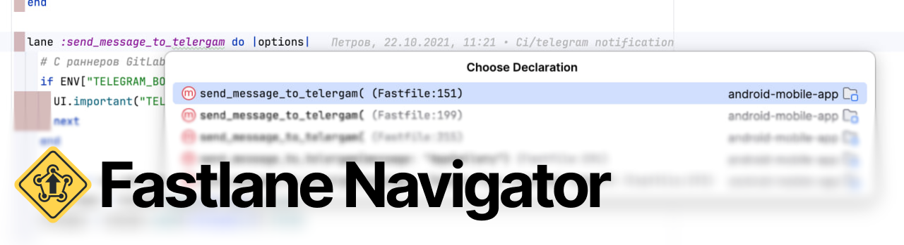

<p align="center">Редактирование Fastlane, навигация по lanes и форматирование в Android Studio.</p>

<p align="center">
  <a href="https://github.com/stfbee/android-studio-fastlane/actions/workflows/build.yml"></a>
  <a href="https://github.com/stfbee/android-studio-fastlane/releases/latest"></a>
  <a href="#требования"></a>
</p>

<p align="center"><a href="README.md">English</a> · Русский</p>

## Возможности

- **Переходы между lanes и вызовами.** Открывайте объявления, находите использования и возвращайтесь к вызовам в текущем Fastfile. Навигация учитывает платформу.
- **Структура Fastfile.** Платформы, обычные, private и override lanes доступны в Structure и File Structure вместе с описаниями `desc`.
- **Переход из CI к коду.** Открывайте объявления lanes из GitHub Actions и GitLab CI, включая параметры Fastlane action и наследуемые GitLab jobs.
- **Подсветка Ruby-конфигов.** Подсветка и иконки файлов работают без отдельного Ruby-плагина и настройки Ruby SDK.
- **Форматирование.** Используйте Reformat Code для сохранённого или несохранённого текста. Содержимое и внутренние отступы многострочных строк сохраняются.

## Установка

1. Скачайте ZIP из [GitHub Releases](https://github.com/stfbee/android-studio-fastlane/releases/latest).
2. Откройте **Settings → Plugins → ⚙ → Install Plugin from Disk…** и выберите ZIP.
3. Перезапустите Android Studio, если она предложит, и откройте Fastfile.

## Использование

| Действие | macOS | Windows / Linux |
| --- | --- | --- |
| Go to Declaration or Usages | `⌘B` / `⌘Click` | `Ctrl+B` / `Ctrl+Click` |
| Find Usages | `⌥F7` | `Alt+F7` |
| File Structure | `⌘F12` | `Ctrl+F12` |
| Reformat Code | `⌘⌥L` | `Ctrl+Alt+L` |

Сочетания клавиш указаны для стандартной раскладки IDE. Переход на вызове открывает объявление lane; то же действие на объявлении ведёт к вызовам.

### Форматирование

Снимите выделение и выберите **Code → Reformat Code**. Ruby определяется автоматически. При необходимости укажите путь в **Settings → Languages & Frameworks → Fastlane → Ruby executable**.

Для форматирования при сохранении включите **Reformat Code** в **Settings → Tools → Actions on Save**. Используются отступы в два пробела и ширина строки из IDE. Форматируется весь файл; форматирование выделения и конфигурации RuboCop / Syntax Tree из проекта не поддерживаются.

### Навигация из CI

Поставьте курсор на имя lane и вызовите Go to Declaration:

```shell
fastlane release
bundle exec fastlane android release
```

- **GitHub Actions:** команды `run` в `.github/workflows/*.yml` и `*.yaml`, а также `with.lane` и `with.subdirectory` у `maierj/fastlane-action`.
- **GitLab CI:** `script`, `before_script` и `after_script` в `.gitlab-ci.yml`, включая `extends` и `!reference` в одном файле.

Учитываются явная платформа, `default_platform`, GitHub `working-directory` и простой `cd`. Если подходят несколько Fastfile, IDE предлагает выбор.

## Поддерживаемые файлы

`Fastfile`, `Fastfile.rb`, `Pluginfile`, `Gemfile`, `Appfile`, `Deliverfile`, `Matchfile`, `Scanfile`, `Snapfile`, `Gymfile`, `Screengrabfile`, `Supplyfile`, `Certfile`, `Sighfile`, `Pemfile`, `Pilotfile` и `Framefile`.

Для этих файлов доступны подсветка, иконки и форматирование. Структура и навигация по lanes работают в Fastfile. `Gemfile.lock` не рассматривается как Ruby.

## Требования

- Android Studio на IntelliJ Platform **262.***.
- Включённые **TextMate Bundles** и встроенный Ruby-бандл.
- Локальный Ruby **только для форматирования**. Форматтер проверяется с Ruby **4.0.9**; Syntax Tree и prettier_print включены в плагин, устанавливать gems не нужно.

<details>
<summary>Нет подсветки синтаксиса?</summary>

Убедитесь, что **TextMate Bundles** включён, а Ruby-бандл присутствует в **Settings → Editor → TextMate Bundles**. Уберите ручную привязку файла к Plain Text, если она есть.

</details>

## Границы поддержки

Объявления и имена lanes должны быть заданы явно. Навигация и Find Usages внутри Ruby ограничены текущим Fastfile; импорты и метапрограммирование не разрешаются. Навигация из CI не вычисляет переменные, не следует во внешние CI-файлы и не интерпретирует произвольные shell-программы или YAML aliases.

Плагин никогда не исполняет Fastfile и не запускает Fastlane.

## Ресурсы

[Документация](https://github.com/stfbee/android-studio-fastlane/blob/main/README.ru.md) · [Релизы](https://github.com/stfbee/android-studio-fastlane/releases) · [История изменений](CHANGELOG.ru.md) · [Планы](ROADMAP.md) · [Участие в разработке](CONTRIBUTING.md)

Нашли ошибку или есть идея? [Создайте issue](https://github.com/stfbee/android-studio-fastlane/issues).

Автор — [Vladislav Onishchenko](https://github.com/stfbee). Независимая интеграция с Fastlane; [источники графики](artwork/fastlane/README.md).
